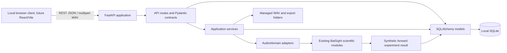
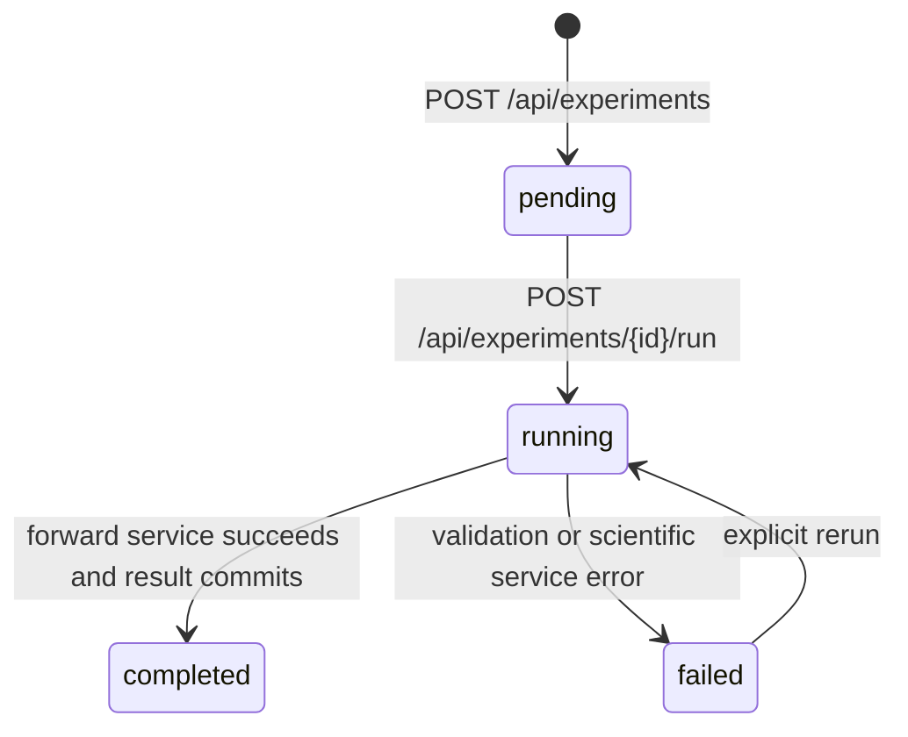

# BatSight Phase 6A — Application architecture

## Scope

Phase 6A added a local REST backend around the existing research package; Phase 6B adds the React/Vite frontend. Scientific routines remain in `src/batsight/signals`, `simulation`, `experiments`, `datasets`, and `reconstruction`; API handlers validate requests, persist records, and call service-layer adapters. No historical algorithm is rewritten. No 3D visualizer, authentication, cloud dependency, or uncalibrated reconstruction engine is included.

The only executable experiment exposed initially is the existing **forward synthetic shoebox experiment** in `batsight.experiments.pipeline.run_experiment`. Its output contains known synthetic geometry and simulated TOA comparisons. It is explicitly not a reconstruction result or real-world validation.

## Architecture

### Component responsibilities

- `application/main.py`: app factory, startup table initialization, CORS for the local Vite development origins, router registration, and local app state.
- `application/config.py`: environment settings and OS-independent default data root at `~/.batsight`.
- `application/api/routes/`: HTTP boundaries for health/system, projects, recordings, and experiments.
- `application/api/schemas/`: Pydantic request and response contracts; OpenAPI is generated by FastAPI.
- `application/models/entities.py`: SQLAlchemy persistence entities and foreign-key relationships.
- `application/services/`: WAV validation/storage, signal facade, simulation facade, labeled reconstruction adapter, and synthetic experiment runner.
- `application/adapters/audio.py`: converts WAV integer/floating samples into existing `AudioSignal` objects without altering stored originals or resampling.
- Existing scientific package modules continue to implement waveform generation, matched filtering, peak detection, TOA extraction, shoebox image-source simulation, forward experiment orchestration, and calibrated labeled dimension fitting.

The service classes keep signal generation, matched filtering, peak detection, TOA extraction, simulation, and reconstruction as separate call boundaries. Only the forward synthetic experiment service is exposed through the initial experiment API. The reconstruction service requires the existing labeled first-order reflection observation contract and is not exposed as a runnable API endpoint in this milestone.

## Backend/frontend communication

The backend is served at `http://127.0.0.1:8000`. JSON CRUD and experiment operations use `/api/...`; WAV uploads use `multipart/form-data`. The React/Vite frontend is served at `http://127.0.0.1:5173` during development and uses `VITE_API_BASE_URL` (default `http://127.0.0.1:8000`). CORS permits localhost/127.0.0.1 port 5173 in development. There is no authentication; bind to loopback for local use.

OpenAPI endpoints are `/docs`, `/redoc`, and `/openapi.json`.

Run with `python -m batsight.application`; `BATSIGHT_HOST` and `BATSIGHT_PORT` configure the listener.

## Persistence design

| Entity/table | Key fields | Relationship |
|---|---|---|
| `Project` / `projects` | name, description, JSON metadata, created/updated UTC timestamps | owns recordings and experiments |
| `Recording` / `recordings` | optional project, original and managed filename, managed path, file size, sample rate, channels, sample count, duration, JSON audio metadata | optional project; file bytes stay on disk |
| `Experiment` / `experiments` | project, name, kind, status, JSON configuration, error message, timestamps | belongs to a project; has at most one result |
| `ExperimentResult` / `experiment_results` | experiment ID, JSON result, timestamp | one-to-one experiment result, cascade deleted |

SQLite enables foreign-key enforcement on each connection. `create_all` initializes a fresh database at application startup. A migration framework is not included yet. JSON data stores configuration and compact result objects; waveform and correlation arrays are omitted from persisted API runs to avoid unnecessarily large database rows.

## Storage and WAV validation

The configurable data root contains `batsight.sqlite3`, `recordings/`, and `exports/`. The default is `Path.home() / ".batsight"`; `BATSIGHT_DATA_DIR` overrides it. Upload bytes are streamed to a unique temporary file, size-checked, parsed as WAV, and atomically moved to a generated UUID filename. The user filename is retained only as metadata. Deletion checks that paths resolve to the managed recording directory and expected generated name before unlinking.

Settings are read from environment variables: `BATSIGHT_APP_NAME`, `BATSIGHT_VERSION`, `BATSIGHT_DATA_DIR`, `BATSIGHT_DATABASE_URL` (SQLite only), `BATSIGHT_MAX_UPLOAD_BYTES`, `BATSIGHT_MAX_RECORDING_SECONDS`, `BATSIGHT_HOST`, and `BATSIGHT_PORT`. If `BATSIGHT_DATABASE_URL` is unset, the database is `<data root>/batsight.sqlite3`.

The current defaults limit uploads to 100 MiB, duration to one hour, analysis to 2,000,000 frames per channel, channels to 64, and sample rate to 8–192 kHz. These are application safeguards, not scientific limits. WAV input may be integer PCM (including packed 24-bit through a bounded non-mmap fallback) or finite float samples. Sample rate is preserved exactly; invalid rates are rejected, never resampled. The database records original file metadata; the stored upload bytes are not normalized or rewritten.

## Scientific service integration

- Generic sine and linear sweep creation delegates to `batsight.signals.generation`; the API WAV adapter serializes PCM16 and does not reproduce the unresolved chirp equation in the 2016 paper.
- Matched filtering and threshold peaks delegate to existing signal modules. The recording-analysis UI adapter runs these methods on one selected recording channel and returns display data; peaks remain unclassified, and this endpoint does not infer direct/echo labels or calibrated room TOAs. The separate calibrated multichannel TOA service remains available only to backend callers supplying its required inputs.
- Synthetic room simulation delegates to `batsight.simulation` and remains forward-only.
- Synthetic experiment execution delegates to `batsight.experiments.pipeline.run_experiment`; the random seed and input configuration are persisted.
- The optional reconstruction service wraps the existing calibrated, labeled shoebox-dimension estimator without copying its objective. It is not currently exposed as an API execution kind.

Data classification is included in results: `synthetic_forward_simulation`, known synthetic ground-truth geometry, `is_room_reconstruction=false`, and `real_world_validation=false`. This prevents a forward simulation from being misrepresented as estimated geometry. Sequential recordings are not treated as synchronized multichannel input.

## Experiment lifecycle

The run endpoint schedules a synchronous scientific service through Starlette/FastAPI background-task handling, which runs sync work off the event loop in the threadpool. The worker updates the SQL row and stores its JSON result. This is an in-process local mechanism, not a durable queue: a process crash can leave an experiment marked `running`; Redis/Celery are intentionally absent. Errors are persisted as a concise message and status `failed`.

## Future integration points

1. The Phase 6B React/TypeScript/Vite client consumes the REST contracts and distinguishes synthetic, real recorded, calibrated, uncalibrated, ground-truth, and estimated data.
2. Three.js/React Three Fiber visualization should display geometry only when an implemented estimator returns it, with method and validation status attached.
3. Real multichannel analysis requires synchronized/calibrated acquisition metadata, known waveform/emission-time convention, and explicit provenance. Single-device sequential files must not be fused as synchronized channels.
4. Database migrations, durable jobs, cancellation, result pagination, and export endpoints should be designed when usage requirements are known.
5. General uncalibrated 3D reconstruction remains blocked by unresolved/recovery questions documented in the research notes; Phase 6A does not unblock or claim that capability.
